# Aula 2 — Fundamentos de Python aplicados aos livros

**Data:** 27/10/2026  
**Programas/pacotes utilizados:** Python 3, Visual Studio Code e Git.  
**Pré-requisito:** ambiente configurado na Aula 1.

## Objetivos

- criar variáveis e reconhecer tipos básicos;
- receber e exibir dados;
- utilizar `if`, `for` e `while`;
- trabalhar com listas e dicionários;
- criar funções;
- compreender, de forma introdutória, como representar um livro em Python;
- relacionar esses conceitos ao futuro CRUD.

---

## 1. Por que aprender Python antes de continuar o site?

Flask é escrito em Python. Uma rota, uma validação de formulário, uma consulta ao banco e um relatório dependem de estruturas básicas da linguagem.

Nesta aula usaremos exemplos do mesmo domínio do projeto final.

---

## 2. Variáveis e tipos

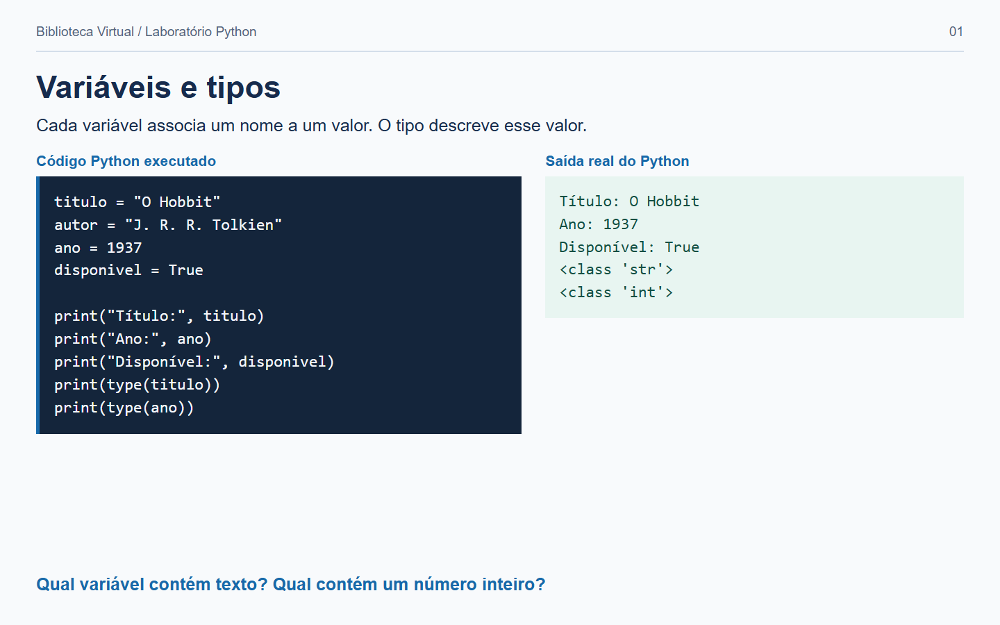

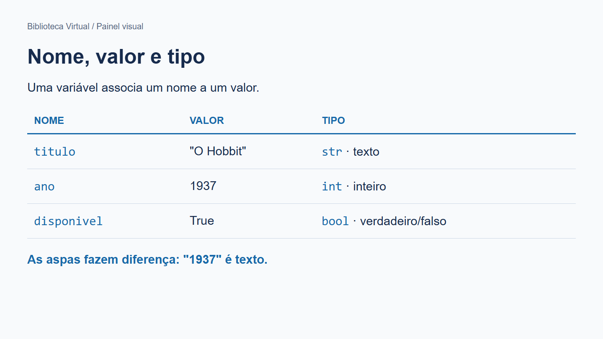

Nome (`ano`), valor (`1937`) e tipo (`int`). `str`, `int` e `bool` descrevem valores dos exemplos iniciais. `list` e `dict` serão explicados mais pra frente.

O valor `"1937"` tem o mesmo tipo de `1937`?

```python
titulo = "O Hobbit"
autor = "J. R. R. Tolkien"
ano = 1937
disponivel = True
```

Os tipos mais usados nesta disciplina serão:

- `str`: textos;
- `int`: números inteiros;
- `bool`: verdadeiro ou falso;
- `list`: coleções ordenadas;
- `dict`: dados organizados por chave e valor.

Podemos verificar um tipo:

```python
print(type(titulo))
print(type(ano))
```

---

## 3. Entrada e saída

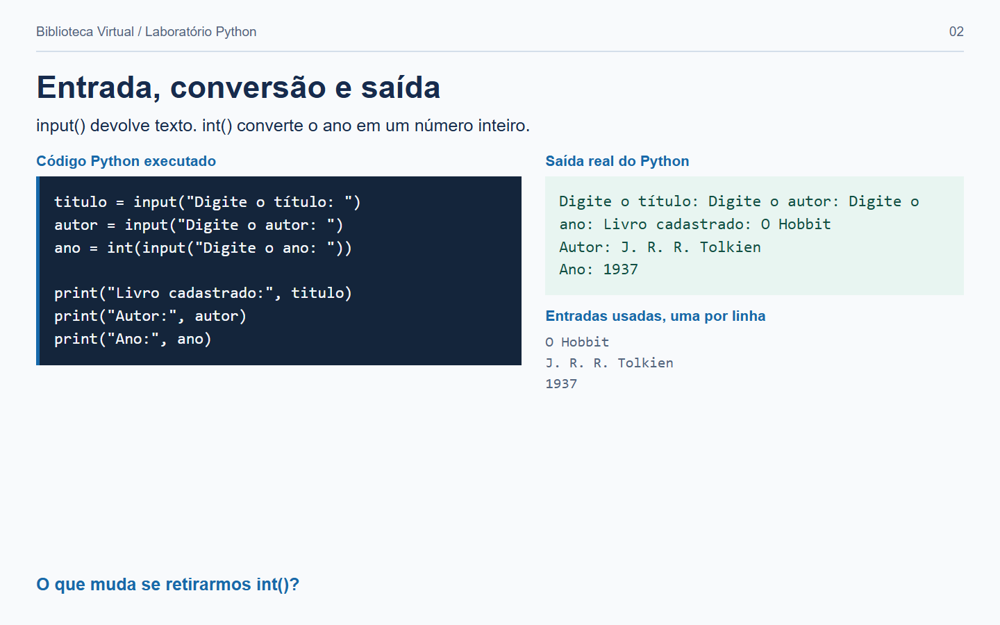

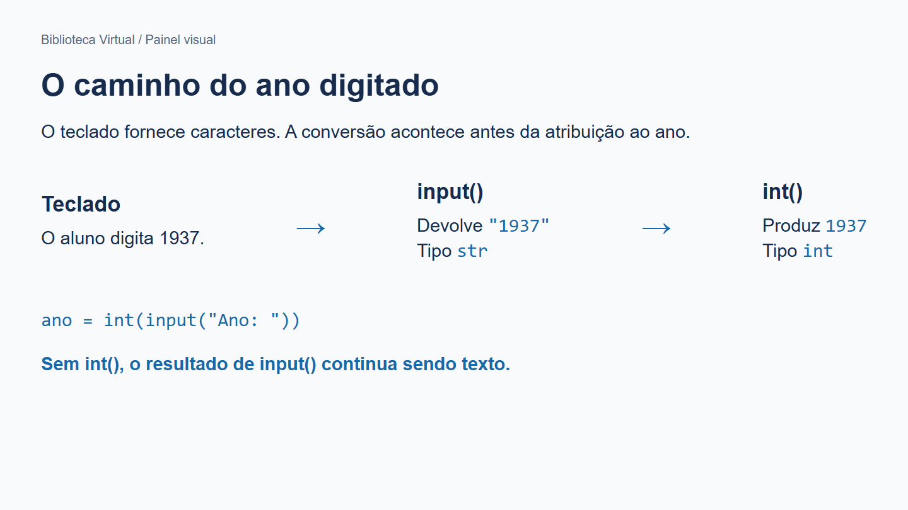

**Acompanhe:** Usuários digitam um título; `input()` devolve texto; a variável recebe esse texto; `print()` o exibe. Para o ano, `int()` faz a conversão antes da atribuição.

```python
titulo = input("Digite o título: ")
autor = input("Digite o autor: ")
ano = int(input("Digite o ano: "))

print("Livro cadastrado:", titulo)
print("Autor:", autor)
print("Ano:", ano)
```

Observe que `input()` devolve texto. Para converter o ano:

```python
ano = int(input("Ano: "))
```

---

## 4. Decisões com `if`

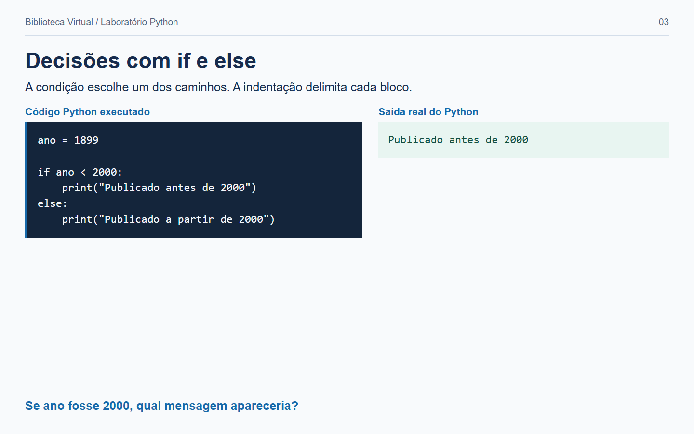

**Tente entender:** com `ano = 2000`, qual caminho será executado?

**Indentação:** as linhas recuadas pertencem ao bloco imediatamente acima. Leia primeiro a condição e depois apenas o caminho escolhido.

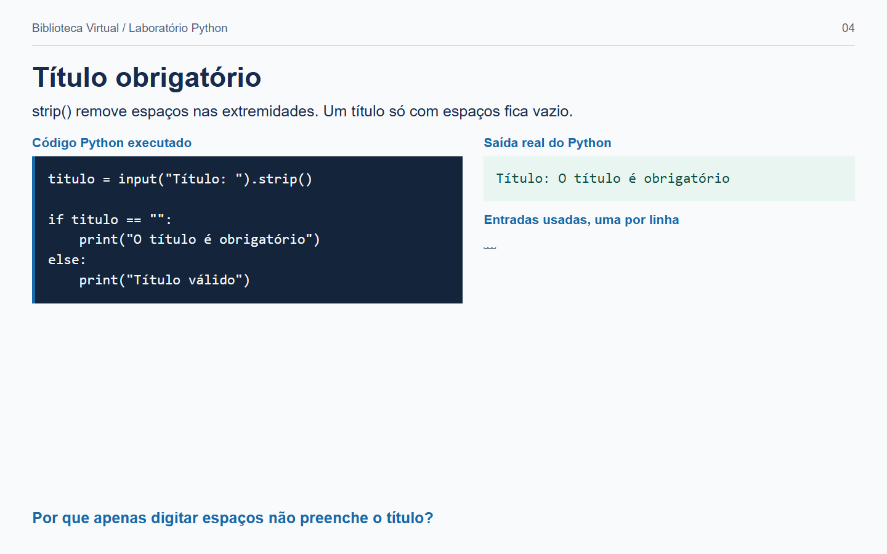

**Detalhe:** `strip()` remove espaços nas extremidades. A captura representa três espaços como `␣␣␣` no campo de entradas, para torná-los visíveis.

```python
ano = 1899

if ano < 2000:
    print("Publicado antes de 2000")
else:
    print("Publicado a partir de 2000")
```

Validação simples:

```python
titulo = input("Título: ").strip()

if titulo == "":
    print("O título é obrigatório")
else:
    print("Título válido")
```

Esse mesmo raciocínio será usado para validar formulários web.

---

## 5. Listas

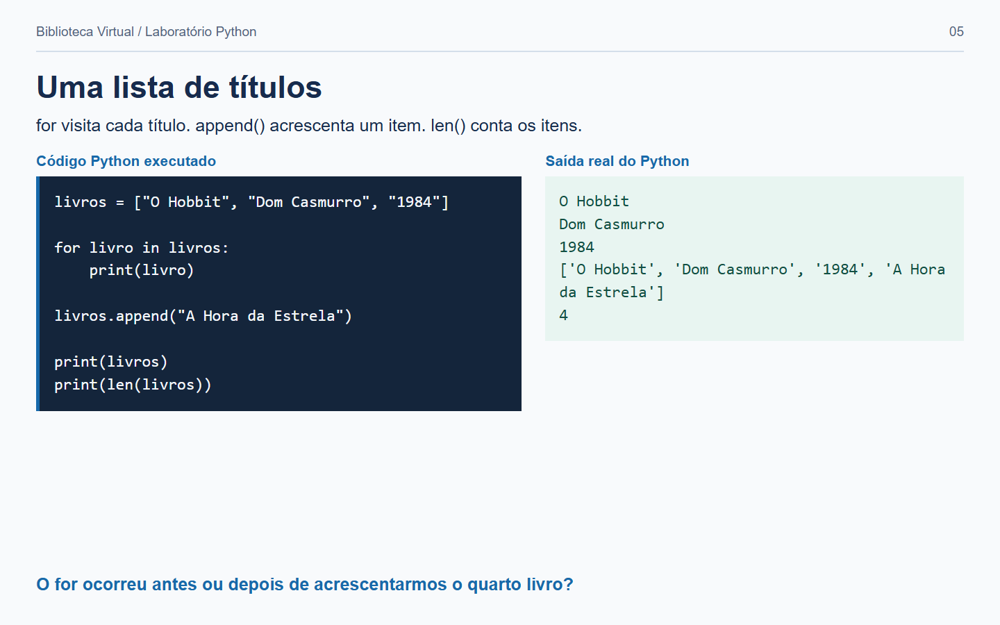

**Imaginem:** cada título é um item de uma sequência ordenada. O `for` visita um item por vez. Depois, `append()` acrescenta um item e `len()` conta a lista atual.

Uma lista pode guardar vários livros:

```python
livros = ["O Hobbit", "Dom Casmurro", "1984"]
```

Percorrendo:

```python
for livro in livros:
    print(livro)
```

Adicionando:

```python
livros.append("A Hora da Estrela")
```

Quantidade:

```python
print(len(livros))
```

A função `len()` ajuda a compreender a ideia de relatório de quantidade.

---

## 6. Dicionários

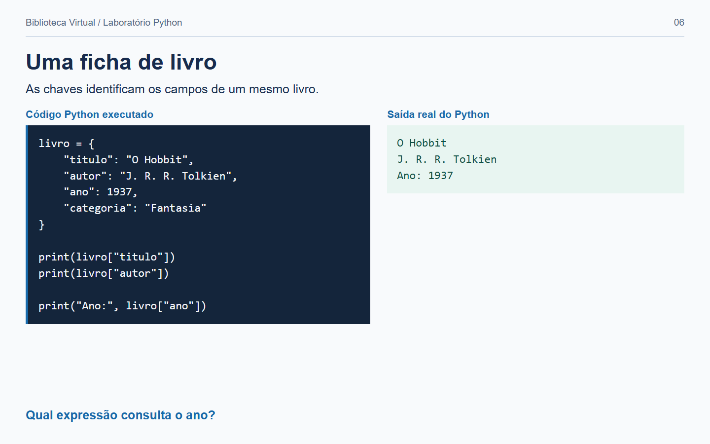

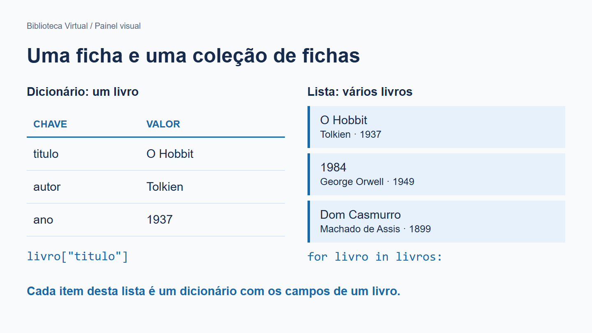

**Entendam a diferença:** uma lista reúne itens; um dicionário relaciona chaves e valores. Aqui cada dicionário reúne os campos de um livro, e a lista de dicionários reúne os livros do catálogo.

**Prática para estudar:** consultar `livro["ano"]` e tentanr entender por que `"ano"` aparece entre aspas.

Um livro possui vários campos. Um dicionário é adequado para introduzir essa ideia:

```python
livro = {
    "titulo": "O Hobbit",
    "autor": "J. R. R. Tolkien",
    "ano": 1937,
    "categoria": "Fantasia"
}
```

Acessando:

```python
print(livro["titulo"])
print(livro["autor"])
```

Lista de dicionários:

```python
livros = [
    {"titulo": "O Hobbit", "autor": "Tolkien", "ano": 1937},
    {"titulo": "1984", "autor": "George Orwell", "ano": 1949},
    {"titulo": "Dom Casmurro", "autor": "Machado de Assis", "ano": 1899}
]
```

---

## 7. Buscando em memória

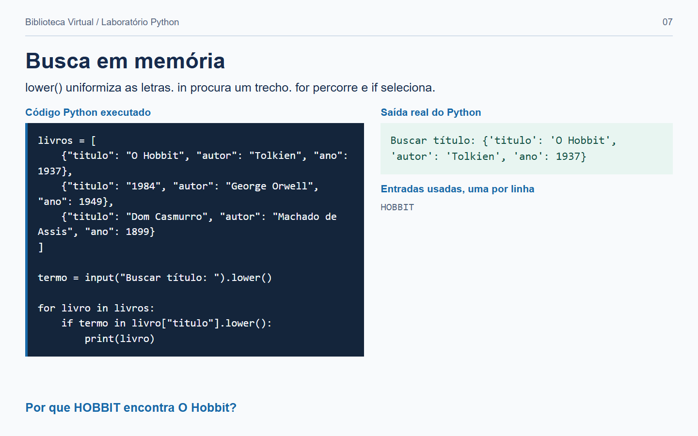

**Façam em casa:** leia um livro, converta seu título para minúsculas, teste a presença do termo e só então tente exibi-lo. Repita com outros livros.

Antes de pesquisar no banco, podemos entender a lógica usando uma lista:

```python
termo = input("Buscar título: ").lower()

for livro in livros:
    if termo in livro["titulo"].lower():
        print(livro)
```

Aqui aparecem conceitos importantes:

- `lower()` transforma texto em minúsculas;
- `in` verifica se um texto aparece dentro de outro;
- o `for` percorre todos os livros;
- o `if` decide quais serão exibidos.

Na Aula 6, o banco SQLite fará esse trabalho com SQL.

---

## 8. Funções

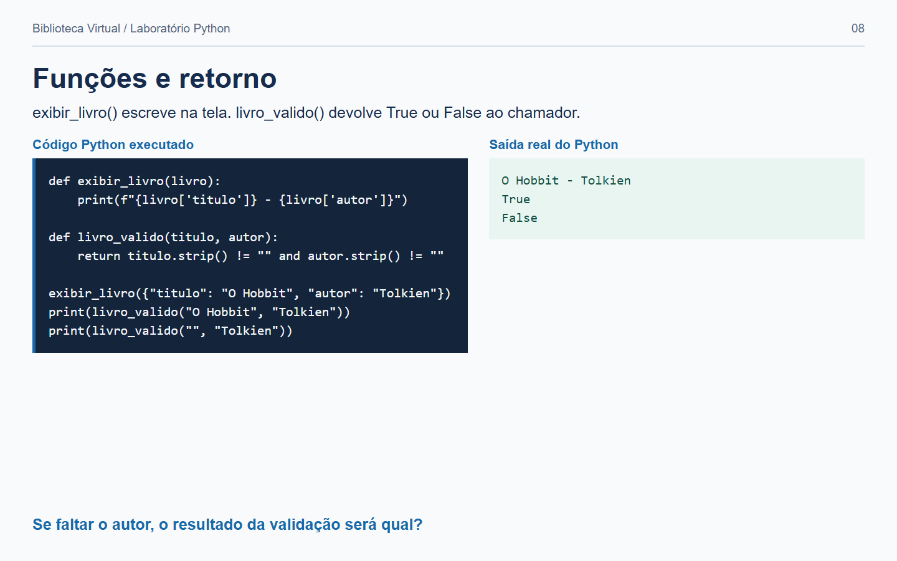

**Explicando:** `def` define a função; os nomes entre parênteses são parâmetros; a chamada fornece os argumentos. `return` devolve um resultado. Na validação, `and` exige que os dois campos estejam preenchidos.

**Detalhe:** a f-string começa com `f` e insere os valores das expressões entre chaves. Definir `exibir_livro()` não a executa: é necessário chamá-la.

**Tente adivinhar:** o que `livro_valido("", "Tolkien")` devolve, true ou false?

Funções evitam repetição e dão nomes claros às operações.

```python
def exibir_livro(livro):
    print(f"{livro['titulo']} - {livro['autor']}")
```

```python
def livro_valido(titulo, autor):
    return titulo.strip() != "" and autor.strip() != ""
```

Uso:

```python
if livro_valido("O Hobbit", "Tolkien"):
    print("Cadastro válido")
```

---

## 9. Introdução a uma classe `Livro`

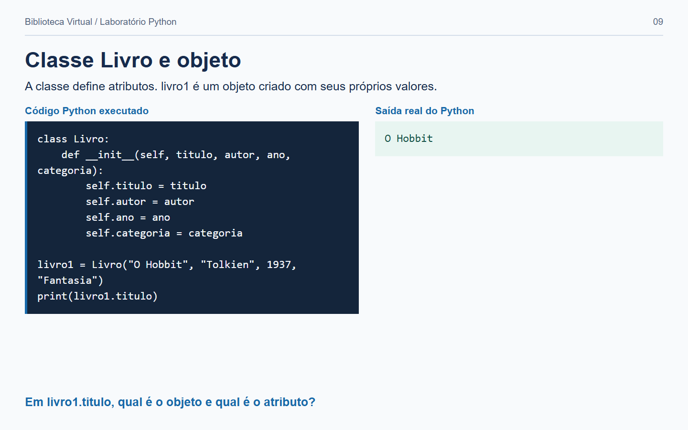

**Conceito:** `Livro` descreve a estrutura; `livro1` é o objeto criado; `titulo` é um atributo desse objeto. `__init__` recebe os valores iniciais e `self` referencia o próprio objeto.

Não faremos orientação a objetos avançada. Porém, é útil entender que podemos representar um livro como um objeto.

```python
class Livro:
    def __init__(self, titulo, autor, ano, categoria):
        self.titulo = titulo
        self.autor = autor
        self.ano = ano
        self.categoria = categoria

livro1 = Livro("O Hobbit", "Tolkien", 1937, "Fantasia")
print(livro1.titulo)
```

No projeto principal, manteremos a persistência simples com `sqlite3`. A classe é uma introdução conceitual ao modelo de dados e pode ser usada como extensão.

---

## 10. Exercício de classe - mini catálogo no terminal

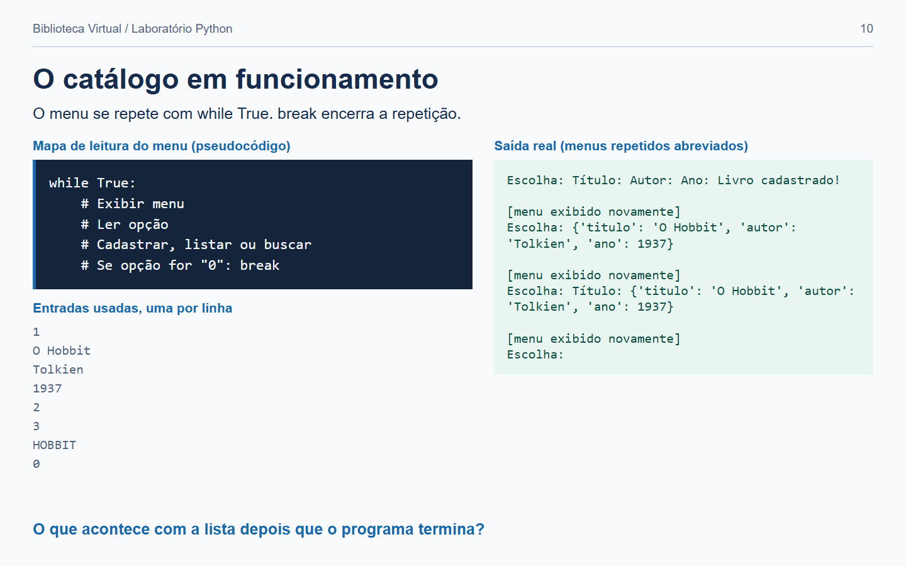

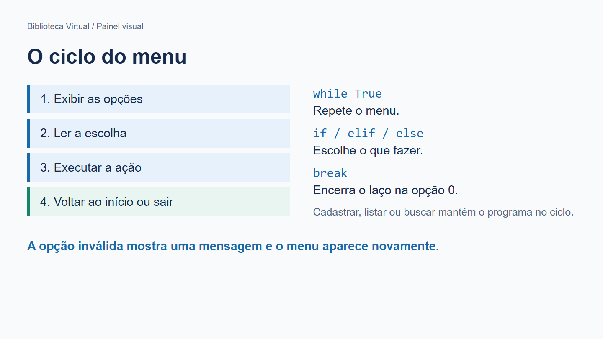

Crie `catalogo_terminal.py`:

```python
livros = []

while True:
    print("\n1 - Cadastrar")
    print("2 - Listar")
    print("3 - Buscar")
    print("0 - Sair")

    opcao = input("Escolha: ")

    if opcao == "1":
        titulo = input("Título: ").strip()
        autor = input("Autor: ").strip()
        ano = int(input("Ano: "))

        livro = {
            "titulo": titulo,
            "autor": autor,
            "ano": ano
        }

        livros.append(livro)
        print("Livro cadastrado!")

    elif opcao == "2":
        for livro in livros:
            print(livro)

    elif opcao == "3":
        termo = input("Título: ").lower()
        for livro in livros:
            if termo in livro["titulo"].lower():
                print(livro)

    elif opcao == "0":
        break

    else:
        print("Opção inválida")
```

Esse programa já possui três ideias presentes no projeto final: **cadastro, listagem e busca**. A diferença aqui é que os dados desaparecem quando o programa fecha. Em outra aula vamos ver como o SQLite resolve isso.

---

## 11. Atividade de casa

**Entrega:** cadastrar dois livros com categoria e editora, listar os campos, conferir a quantidade `2` e buscar um autor usando letras maiúsculas. Demonstrar também uma busca sem correspondência.

**Dica:** a entrada fornece dados; a validação verifica condições; o processamento decide a ação; a lista armazena temporariamente; a exibição mostra o resultado.

Adapte o catálogo para incluir:

- categoria;
- editora;
- uma opção para mostrar a quantidade de livros cadastrados;
- uma busca por autor.

### Resultado esperado

Um sistema é a combinação de pequenas operações:

```text
entrada -> validação -> processamento -> armazenamento -> exibição
```

---

## 12. Git

**No computador de vocês(alunos):** comandos no repositório da Biblioteca Virtual criado na Aula 1:

Ao finalizar:

```bat
git add .
git commit -m "Aula 2 - fundamentos de Python"
```

---

## Revisão

Antes da Aula 3, vocês devem revisar, caso não tenham entendido:

1. o que é uma variável;
2. a diferença entre `str` e `int`;
3. para que serve `if`;
4. para que serve `for`;
5. o que é uma lista;
6. o que é um dicionário;
7. por que usamos funções.

Na próxima aula, vamos usar isso para as páginas web com Flask.
