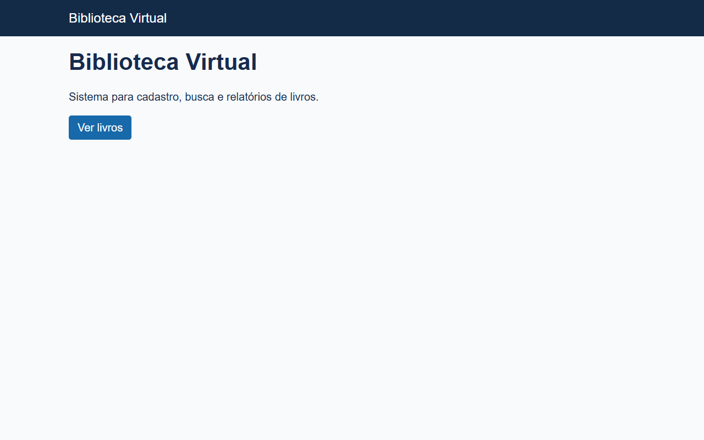
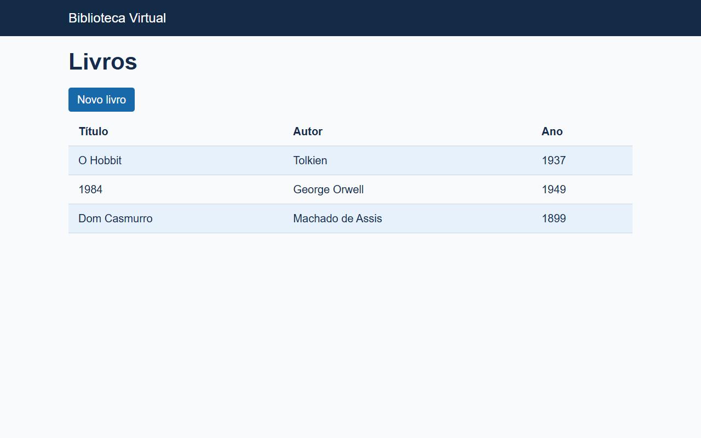
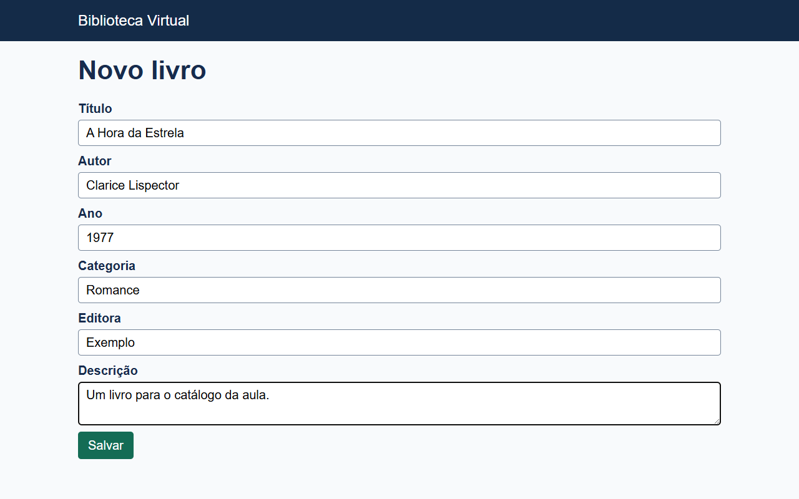
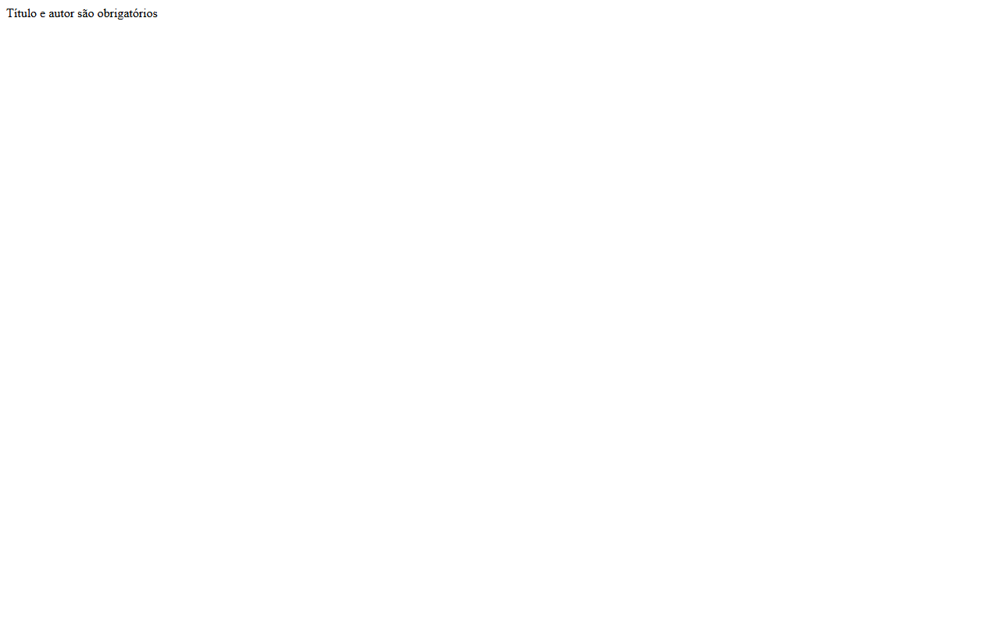
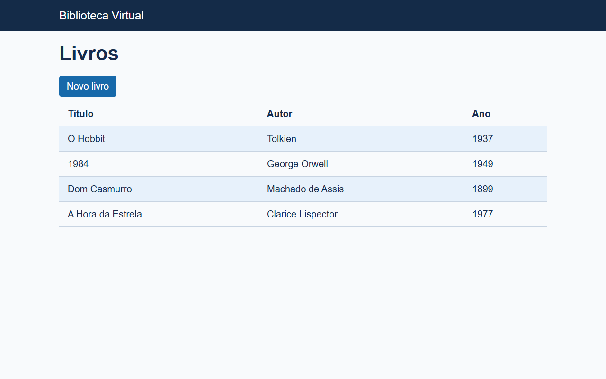

# Aula 3 — Flask: rotas, templates e formulários

**Data:** 03/11/2026  
**Programas/pacotes utilizados:** Python 3, Flask, Visual Studio Code, navegador e Git.

## Objetivos

- compreender cliente, servidor, requisição e resposta;
- criar rotas Flask;
- renderizar templates HTML;
- reutilizar um layout base com Jinja2;
- criar formulários HTML;
- compreender GET e POST;
- receber dados de formulário no Python.

---

## 1. Como uma aplicação Flask funciona?

Vamos abrir a Biblioteca Virtual no navegador e identificar quem solicita a página e quem devolve a resposta. Depois, comparamos com o catálogo que executamos no terminal na Aula 2.



Quando acessamos:

```text
http://127.0.0.1:5000/livros
```

o navegador envia uma requisição. Flask identifica qual função corresponde à rota `/livros`, executa essa função e devolve uma resposta.

```text
Navegador -> GET /livros -> Flask -> função Python
Navegador <- HTML         <- Flask <- resultado
```

---

## 2. Rotas

Vamos acessar /livros e identificar qual função atende esse endereço. Depois, acessamos /inexistente para observar a resposta 404 de um caminho sem rota.

Em `app.py`:

```python
from flask import Flask, render_template

app = Flask(__name__)

@app.route("/")
def inicio():
    return render_template("index.html")

@app.route("/livros")
def listar_livros():
    return "Página de livros"

if __name__ == "__main__":
    app.run(debug=True)
```

Cada `@app.route(...)` associa um endereço a uma função.

---

## 3. Templates

Vamos comparar o cabeçalho das três páginas. Ele vem de base.html. Em index.html, localizamos extends e os blocos preenchidos pela página inicial.

Vamos criar esta estrutura:

```text
templates/
├── base.html
├── index.html
├── livros.html
└── cadastrar.html
```

### `base.html`

```html
<!doctype html>
<html lang="pt-BR">
<head>
    <meta charset="utf-8">
    <meta name="viewport" content="width=device-width, initial-scale=1">
    <title>Biblioteca</title>
    <link href="https://cdn.jsdelivr.net/npm/bootstrap@5/dist/css/bootstrap.min.css" rel="stylesheet">
</head>
<body>
<nav class="navbar navbar-dark bg-dark mb-4">
    <div class="container">
        <a class="navbar-brand" href="/">Biblioteca Virtual</a>
    </div>
</nav>

<main class="container">
    
</main>
</body>
</html>
```

### `index.html`

```html


Início


<h1>Biblioteca Virtual</h1>
<p>Sistema para cadastro, busca e relatórios de livros.</p>
<a class="btn btn-primary" href="/livros">Ver livros</a>

```

---

## 4. Enviando dados do Python ao HTML

Retomamos a lista de dicionários da Aula 2. Cada iteração do for em Jinja produz uma linha da tabela.



Temporariamente, usaremos uma lista em memória:

```python
livros = [
    {"id": 1, "titulo": "O Hobbit", "autor": "Tolkien", "ano": 1937},
    {"id": 2, "titulo": "1984", "autor": "George Orwell", "ano": 1949}
]

@app.route("/livros")
def listar_livros():
    return render_template("livros.html", livros=livros)
```

`livros.html`:

```html



<h1>Livros</h1>

<table class="table table-striped">
    <thead>
        <tr>
            <th>Título</th>
            <th>Autor</th>
            <th>Ano</th>
        </tr>
    </thead>
    <tbody>
        
        <tr>
            <td>{{ livro.titulo }}</td>
            <td>{{ livro.autor }}</td>
            <td>{{ livro.ano }}</td>
        </tr>
        
    </tbody>
</table>

```

---

## 5. GET e POST

Antes de testarmos, vamos prever qual método o navegador usa ao clicar em Novo livro e em Salvar. Depois do envio, observamos que o navegador carrega a listagem com outro GET.

Nesta disciplina, usamos os métodos assim:

- **GET:** pedir uma página ou consultar dados;
- **POST:** enviar dados para criar ou alterar algo.

Exemplo:

```text
GET  /livros/cadastrar -> abre o formulário
POST /livros/cadastrar -> envia o formulário
```

---

## 6. Formulário de cadastro

No formulário, comparamos name="titulo" no HTML com request.form["titulo"] no Python. O nome liga os dois lados. A atividade acrescenta editora e descrição aos campos do exemplo.



`cadastrar.html`:

```html



<h1>Novo livro</h1>

<form method="post">
    <div class="mb-3">
        <label class="form-label">Título</label>
        <input class="form-control" type="text" name="titulo" required>
    </div>

    <div class="mb-3">
        <label class="form-label">Autor</label>
        <input class="form-control" type="text" name="autor" required>
    </div>

    <div class="mb-3">
        <label class="form-label">Ano</label>
        <input class="form-control" type="number" name="ano">
    </div>

    <div class="mb-3">
        <label class="form-label">Categoria</label>
        <input class="form-control" type="text" name="categoria">
    </div>

    <button class="btn btn-success">Salvar</button>
</form>

```

---

## 7. Recebendo o formulário

Abrimos o formulário para testar o GET. Depois, preenchemos os campos, clicamos em Salvar e acompanhamos o retorno à listagem.

```python
from flask import Flask, render_template, request, redirect

@app.route("/livros/cadastrar", methods=["GET", "POST"])
def cadastrar_livro():
    if request.method == "POST":
        titulo = request.form["titulo"]
        autor = request.form["autor"]
        ano = request.form["ano"]
        categoria = request.form["categoria"]

        print(titulo, autor, ano, categoria)

        return redirect("/livros")

    return render_template("cadastrar.html")
```

Nesta aula os dados podem ser apenas impressos ou acrescentados à lista. Na próxima aula serão gravados permanentemente no SQLite.

---

## 8. `url_for`

Vamos comparar o caminho /livros com o nome listar_livros. Qual dos dois passamos para url_for?

Usamos `url_for` para evitar espalhar endereços escritos manualmente.

```python
from flask import url_for
```

No template:

```html
<a href="{{ url_for('listar_livros') }}">Livros</a>
```

O nome usado em `url_for` corresponde ao nome da função da rota.

---

## 9. Validação simples no servidor

Vamos testar um título com três espaços. O campo tem caracteres, mas strip() remove os espaços e a aplicação responde com 400.



```python
titulo = request.form["titulo"].strip()
autor = request.form["autor"].strip()

if titulo == "" or autor == "":
    return "Título e autor são obrigatórios", 400
```

O atributo HTML `required` ajuda o usuário, mas não substitui a validação no servidor.

---

## 10. Atividade de classe 01

Na prática, fazemos as rotas responderem, compartilhamos o layout, montamos a tabela e ligamos os seis campos ao POST.

Vamos construir as páginas:

```text
/
/livros
/livros/cadastrar
```

A listagem deverá ter:

- título da página;
- botão **Novo livro**;
- tabela Bootstrap;
- pelo menos três registros temporários.

O formulário deverá ter:

- título;
- autor;
- ano;
- categoria;
- editora;
- descrição.

---

## 11. Atividade de classe 02

Cadastramos A Hora da Estrela e conferimos a nova linha. Ao reiniciar o servidor, os três registros iniciais voltam porque estão escritos no código. O cadastro novo desaparece.



Após receber um `POST`, adicionamos o livro à lista em memória e redirecionamos para `/livros`.

Ao reiniciarmos o servidor, perdemos os novos cadastros. Vamos resolver essa limitação na Aula 4.

---

## 12. Commit

Executamos os comandos de Git no repositório da Biblioteca Virtual.

```bat
git add .
git commit -m "Aula 3 - rotas templates e formularios"
```

---

## Revisão

Assuntos que podem cair na prova:

- o que é uma rota;
- o que faz `render_template`;
- o que é Jinja2;
- a diferença prática entre GET e POST;
- para que serve `request.form`;
- por que a lista em memória não é suficiente para um sistema real.
