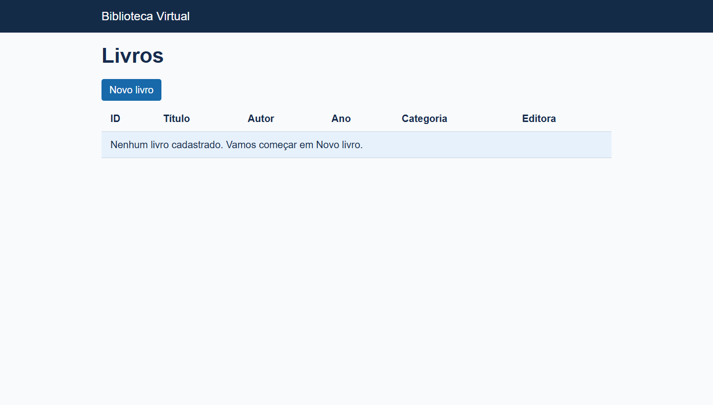
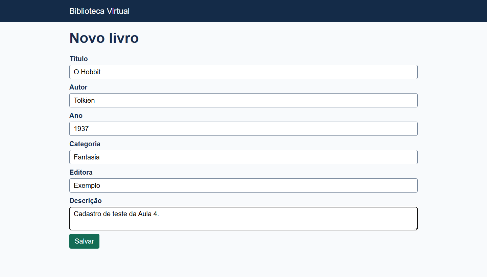
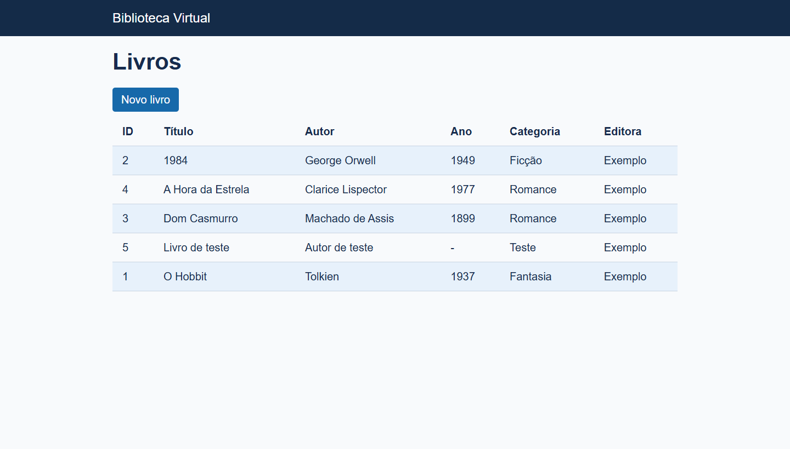

# Aula 4 - SQLite e início do CRUD: cadastrar e listar

**Data:** 10/11/2026  
**Tema:** persistência dos livros com Flask e SQLite.

---

## 1. Revisão breve da Aula 3

Na Aula 3, criamos três páginas na Biblioteca Virtual.

| Endereço | Método | O que fazemos |
|---|---|---|
| `/` | GET | Abrimos a página inicial |
| `/livros` | GET | Consultamos a listagem |
| `/livros/cadastrar` | GET | Abrimos o formulário |
| `/livros/cadastrar` | POST | Enviamos os dados do livro |

Reutilizamos `base.html` com Jinja2, usamos `render_template()` para gerar HTML e recebemos os campos com `request.form`. Depois do cadastro, usamos `redirect()` e `url_for()` para voltar à listagem.

Os livros ficavam em uma lista Python. Ao reiniciar o servidor, os novos cadastros desapareciam. Os três livros definidos no código voltavam porque a lista era criada novamente.

**Vamos retomar:** em qual requisição recebemos os dados do cadastro? O que `url_for("listar_livros")` produz?

Nesta aula, vamos conservar esse fluxo e armazenar os dados em um arquivo de banco.

---

## 2. Assuntos da Aula 4

### 2.1. Persistência com SQLite

Persistência é a conservação dos dados depois que encerramos o programa. Usaremos o SQLite, que guarda as tabelas em um arquivo local chamado `biblioteca.db`. O módulo `sqlite3` acompanha o Python.

O percurso do cadastro será este:

```text
Formulário HTML
      ↓ POST
Flask / Python
      ↓ INSERT e commit
SQLite → database/biblioteca.db
      ↓ SELECT
Template Jinja → tabela HTML no navegador
```

### 2.2. Banco, tabela, coluna e registro

| id | titulo | autor | ano | categoria |
|---:|---|---|---:|---|
| 1 | O Hobbit | Tolkien | 1937 | Fantasia |
| 2 | 1984 | George Orwell | 1949 | Ficção |

- O **banco** reúne os dados da aplicação.
- A **tabela** organiza dados relacionados, como os livros.
- A **coluna** representa um campo, como título ou ano.
- O **registro** é uma linha completa, correspondente a um livro.
- A **chave primária** identifica cada registro. Usaremos `id`, gerado pelo banco.

Dois livros podem ter o mesmo título e IDs diferentes. Na listagem, a posição da linha depende da ordenação. O ID continua identificando o registro.

### 2.3. Os comandos SQL que vamos usar

| Comando ou operação | Finalidade |
|---|---|
| `CREATE TABLE IF NOT EXISTS` | Criar a tabela se ela ainda não existir |
| `INSERT INTO` | Incluir um registro |
| `SELECT` | Consultar registros |
| `ORDER BY titulo` | Ordenar a consulta por título |
| `commit()` | Confirmar a gravação |
| `close()` | Encerrar a conexão |

Primeiro, criamos a estrutura. Depois, inserimos e consultamos os livros.

```sql
INSERT INTO livros (titulo, autor, ano, categoria)
VALUES ('O Hobbit', 'Tolkien', 1937, 'Fantasia');

SELECT * FROM livros;
SELECT * FROM livros ORDER BY titulo;
```

No código Python, enviamos os valores separadamente por parâmetros `?`. A ordem dos valores deve corresponder à ordem das colunas. Assim, um título com apóstrofo também pode ser armazenado corretamente.

### 2.4. A relação com CRUD

| Letra | Operação | SQL | Funcionalidade |
|---|---|---|---|
| C | Create | INSERT | Cadastrar |
| R | Read | SELECT | Listar ou consultar |
| U | Update | UPDATE | Editar |
| D | Delete | DELETE | Excluir |

Nesta aula, implementamos cadastro e leitura. Na Aula 5, vamos acrescentar edição e exclusão.

---

## 3. Materiais que vamos usar

- A pasta da Biblioteca Virtual construída na Aula 3.
- Python 3 e o ambiente virtual com Flask.
- VS Code, navegador e terminal.
- O módulo `sqlite3`, incluído no Python, e `Path`, da biblioteca padrão.
- Git para registrar o avanço.
- Os arquivos de apoio em `projeto/`, com a atividade concluída para consulta.

Usaremos o mesmo `requirements.txt` da aula anterior. O SQLite dispensa uma instalação separada de servidor. Os estilos locais permitem acompanhar a atividade mesmo quando o CDN do Bootstrap estiver indisponível.

Vamos trabalhar na pasta que contém `app.py`. No terminal do Windows, com o ambiente virtual ativo, podemos conferir:

```bat
python --version
python -m pip show Flask
```

Se precisarmos restaurar as dependências em uma cópia nova:

```bat
python -m pip install -r requirements.txt
```

---

## 4. Atividade guiada

### Passo 1 - Conferimos o ponto de partida

Abrimos o projeto da Aula 3 e localizamos `app.py`, o formulário e a listagem. Encerramos o servidor com `Ctrl + C` antes de editar.

Vamos manter esta organização:

```text
biblioteca_virtual/
├── app.py
├── requirements.txt
├── templates/
│   ├── base.html
│   ├── index.html
│   ├── livros.html
│   └── cadastrar.html
├── static/
└── database/
    └── biblioteca.db   ← criado automaticamente
```

Os seis campos do formulário continuam sendo `titulo`, `autor`, `ano`, `categoria`, `editora` e `descricao`. Conferimos os atributos `name` antes de avançar.

O projeto de apoio corresponde à versão final. Para praticar passo a passo, partimos da pasta da Aula 3 e aplicamos as alterações abaixo.

---

### Passo 2 - Preparamos a conexão

No início de `app.py`, reunimos os imports e a configuração abaixo. Substituímos a lista global `livros = [...]` por `CAMINHO_BANCO`.

```python
import sqlite3
from pathlib import Path

from flask import Flask, redirect, render_template, request, url_for

app = Flask(__name__)
CAMINHO_BANCO = Path(__file__).resolve().parent / "database" / "biblioteca.db"
```

O caminho parte da pasta de `app.py`. Com isso, acessamos o mesmo banco mesmo quando iniciamos o programa a partir de outro diretório.

Acrescentamos a função de conexão:

```python
def conectar():
    conexao = sqlite3.connect(CAMINHO_BANCO)
    conexao.row_factory = sqlite3.Row
    return conexao
```

`sqlite3.Row` permite consultar resultados pelo nome da coluna, como `livro["titulo"]`. Jinja também permite usar `livro.titulo` no template.

---

### Passo 3 - Criamos a tabela automaticamente

Acrescentamos a função abaixo antes das rotas:

```python
def criar_tabela():
    CAMINHO_BANCO.parent.mkdir(parents=True, exist_ok=True)
    conexao = conectar()
    try:
        conexao.execute("""
            CREATE TABLE IF NOT EXISTS livros (
                id INTEGER PRIMARY KEY AUTOINCREMENT,
                titulo TEXT NOT NULL,
                autor TEXT NOT NULL,
                ano INTEGER,
                categoria TEXT,
                editora TEXT,
                descricao TEXT,
                arquivo_pdf TEXT
            )
        """)
        conexao.commit()
    finally:
        conexao.close()
```

A coluna `id` usa `INTEGER PRIMARY KEY AUTOINCREMENT`. O banco gera esse identificador. `NOT NULL` impede valores SQL nulos em título e autor. Para impedir textos vazios ou só com espaços, continuamos validando o formulário.

`arquivo_pdf` prepara a estrutura para uma aula posterior. Por enquanto, deixamos essa coluna vazia.

O bloco `try/finally` garante que `close()` seja executado ao sair do bloco, inclusive se um comando falhar. A gravação depende de `commit()`.

Ao final de `app.py`, usamos:

```python
criar_tabela()

if __name__ == "__main__":
    app.run()
```

A chamada cria a pasta e a tabela antes de atendermos as requisições. `IF NOT EXISTS` permite iniciar novamente sem recriar uma tabela existente. Esse comando também não modifica uma tabela antiga que já tenha outra estrutura.

---

### Passo 4 - Consultamos os livros no SQLite

Substituímos a rota `listar_livros()` anterior por esta versão. Mantemos uma única definição para cada rota.

```python
@app.route("/livros")
def listar_livros():
    conexao = conectar()
    try:
        livros = conexao.execute(
            "SELECT * FROM livros ORDER BY titulo"
        ).fetchall()
    finally:
        conexao.close()
    return render_template("livros.html", livros=livros)
```

`fetchall()` reúne os registros da consulta antes de fecharmos a conexão. A variável local `livros` recebe esse resultado e segue para o mesmo template.

A rota da página inicial continua assim:

```python
@app.route("/")
def inicio():
    return render_template("index.html")
```

---

### Passo 5 - Gravamos o formulário

Substituímos a função `cadastrar_livro()` completa:

```python
@app.route("/livros/cadastrar", methods=["GET", "POST"])
def cadastrar_livro():
    if request.method == "POST":
        titulo = request.form.get("titulo", "").strip()
        autor = request.form.get("autor", "").strip()
        ano = request.form.get("ano", "").strip()
        categoria = request.form.get("categoria", "").strip()
        editora = request.form.get("editora", "").strip()
        descricao = request.form.get("descricao", "").strip()

        if not titulo or not autor:
            return "Título e autor são obrigatórios", 400

        try:
            ano = int(ano) if ano else None
        except ValueError:
            return "O ano deve ser um número inteiro", 400
        if ano is not None and not -(2**63) <= ano < 2**63:
            return "Ano fora do intervalo de inteiros do SQLite", 400

        conexao = conectar()
        try:
            conexao.execute(
                """
                INSERT INTO livros
                (titulo, autor, ano, categoria, editora, descricao)
                VALUES (?, ?, ?, ?, ?, ?)
                """,
                (titulo, autor, ano, categoria, editora, descricao),
            )
            conexao.commit()
        finally:
            conexao.close()
        return redirect(url_for("listar_livros"))

    return render_template("cadastrar.html")
```

Lemos os mesmos seis campos da Aula 3. Usamos `.get()` para receber campos ausentes como texto vazio, e `strip()` remove espaços nas extremidades.

O ano vazio vira `None`, que o SQLite guarda como `NULL`. Um ano preenchido passa por `int()`. Se a conversão falhar, devolvemos 400. A verificação de intervalo evita valores que ultrapassem o inteiro de 64 bits aceito pelo SQLite.

No `INSERT`, os seis parâmetros correspondem às seis colunas. O ID é gerado pelo banco, por isso fica fora dos campos enviados. Depois de `commit()`, redirecionamos para a listagem.

---

### Passo 6 - Adaptamos a tabela HTML

Substituímos o conteúdo de `templates/livros.html` pelo código abaixo:

```html



<h1>Livros</h1>
<a class="btn btn-primary mb-3" href="{{ url_for('cadastrar_livro') }}">Novo livro</a>
<div style="overflow-x: auto">
    <table class="table table-striped">
        <thead>
            <tr>
                <th>ID</th><th>Título</th><th>Autor</th><th>Ano</th>
                <th>Categoria</th><th>Editora</th>
            </tr>
        </thead>
        <tbody>
            
            <tr>
                <td>{{ livro.id }}</td>
                <td>{{ livro.titulo }}</td>
                <td>{{ livro.autor }}</td>
                <td>{{ livro.ano if livro.ano is not none else "-" }}</td>
                <td>{{ livro.categoria or "-" }}</td>
                <td>{{ livro.editora or "-" }}</td>
            </tr>
            
            <tr><td colspan="6">Nenhum livro cadastrado. Vamos começar em Novo livro.</td></tr>
            
        </tbody>
    </table>
</div>

```

A tabela mostra ID, título, autor, ano, categoria e editora. A descrição permanece armazenada no banco. O trecho `` do laço apresenta uma mensagem quando a consulta está vazia.

Para o ano, verificamos `is not none`. Assim, o traço representa a ausência de um valor.

---

### Passo 7 - Iniciamos e cadastramos cinco livros

Executamos:

```bat
python app.py
```

Abrimos http://127.0.0.1:5000/livros. Na primeira execução, encontramos a tabela vazia.



Os três registros temporários da Aula 3 não são transferidos automaticamente. Vamos cadastrá-los pelo formulário, junto com outros dois exemplos.

| Título | Autor | Ano | Categoria | Editora |
|---|---|---:|---|---|
| O Hobbit | Tolkien | 1937 | Fantasia | Exemplo |
| 1984 | George Orwell | 1949 | Ficção | Exemplo |
| Dom Casmurro | Machado de Assis | 1899 | Romance | Exemplo |
| A Hora da Estrela | Clarice Lispector | 1977 | Romance | Exemplo |
| Livro de teste | Autor de teste | deixar vazio | Teste | Exemplo |

Usamos “Exemplo” como editora fictícia nos dados de teste. Podemos preencher a descrição com uma frase curta.



Depois de cada envio, retornamos à listagem. Conferimos a ordenação por título e o traço no livro sem ano. Os IDs refletem a inclusão dos registros e podem aparecer fora de ordem na consulta por título.



---

### Passo 8 - Comprovamos a persistência

Encerramos o servidor com `Ctrl + C`, executamos `python app.py` novamente e recarregamos `/livros`.

Precisamos reencontrar os cinco livros com os mesmos IDs. Esse teste comprova que estamos lendo os dados gravados no arquivo.


---

### Passo 9 - Conferimos a validação e os erros comuns

- Enviamos um título composto por espaços. Esperamos a resposta 400 e nenhuma inclusão.
- Cadastramos um ano vazio. Esperamos o traço na tabela.
- Se aparecer `no such table: livros`, conferimos a chamada de `criar_tabela()` e o caminho do arquivo.
- Se aparecer `database is locked`, verificamos se outro programa mantém uma transação de escrita aberta. Encerramos essa transação e conferimos o fechamento das conexões.
- Se aparecer erro de conversão do ano, conferimos o tratamento de texto vazio e o bloco `try/except`.
- Se a tabela parecer voltar vazia, conferimos se estamos executando a mesma cópia do projeto e usando o mesmo arquivo de banco.

---

### Passo 10 - Registramos o avanço

No repositório do projeto, conferimos o `.gitignore`:

```gitignore
.venv/
__pycache__/
database/*.db
database/*.db-journal
uploads/*
!uploads/.gitkeep
```

O código cria o banco durante a execução. Versionamos os arquivos que permitem reproduzir a estrutura.

```bat
git add .
git commit -m "Aula 4 - SQLite cadastro e listagem"
```

---

## 5. Exercício de casa

Concluir a atividade e registrar os resultados em um arquivo `exercicio-casa-aula-04.md` no github do grupo.

1. Conferimos os cinco cadastros e anotamos a ordem exibida na tabela.
2. Encerramos e iniciamos o servidor. Anotamos os IDs antes e depois e verificamos se permanecem iguais.
3. Acrescentamos um sexto livro com um apóstrofo no título, como **Livro d'água**, para conferir o uso dos parâmetros.
4. Tentamos cadastrar um título só com espaços e confirmamos que a quantidade de livros permanece igual.
5. Explicamos em poucas linhas o papel de `commit()` e a diferença entre guardar um livro na lista e inseri-lo no SQLite.
6. Registramos uma captura da listagem após o reinício.

O resultado esperado é uma aplicação com cadastro e listagem persistentes, ordenação por título e tratamento de ano vazio.

---

## 6. Tópicos para revisão

- Como distinguimos banco, tabela, coluna e registro?
- Por que precisamos de uma chave primária?
- Qual é o papel de `CREATE TABLE IF NOT EXISTS`?
- Como os parâmetros `?` se relacionam aos valores do cadastro?
- Para que usamos `INSERT`, `SELECT` e `ORDER BY`?
- O que fazemos com `commit()`, `fetchall()` e `close()`?
- Como representamos a ausência de ano em Python e no SQLite?
- Como verificamos que os dados permaneceram após encerrar o programa?
- Quais operações de CRUD implementamos nesta aula?

---

## 7. Encerramento

Concluímos a ligação entre formulário, Flask e SQLite. Agora cadastramos livros e consultamos registros que permanecem disponíveis ao reiniciar a aplicação.

Na Aula 5, vamos continuar a partir desse banco e acrescentar os fluxos de detalhamento, edição e exclusão dos livros.
