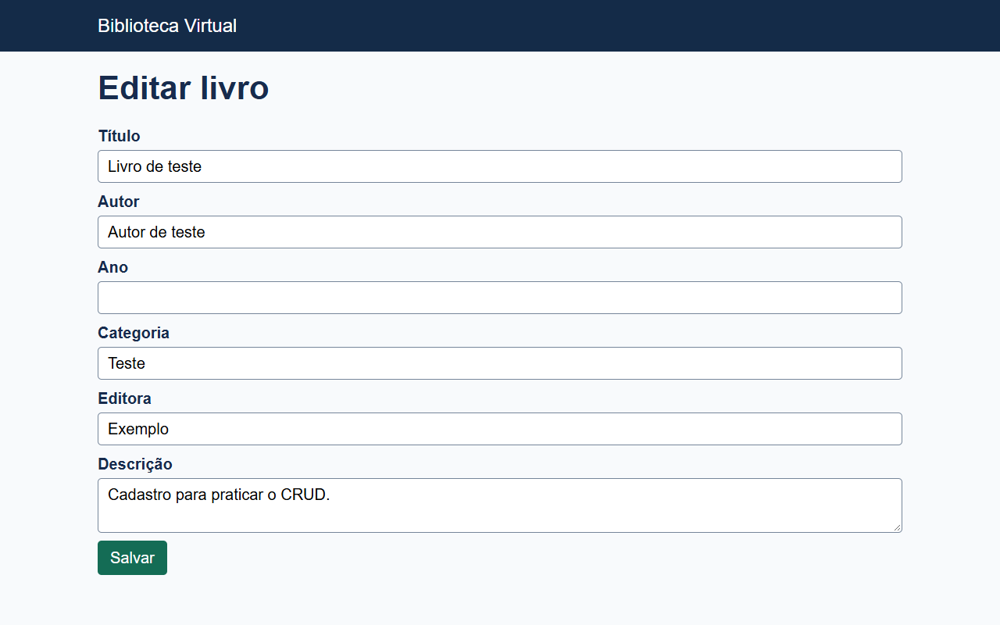
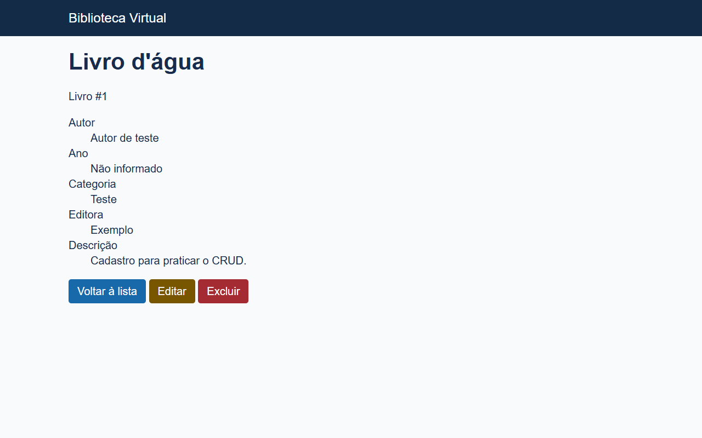
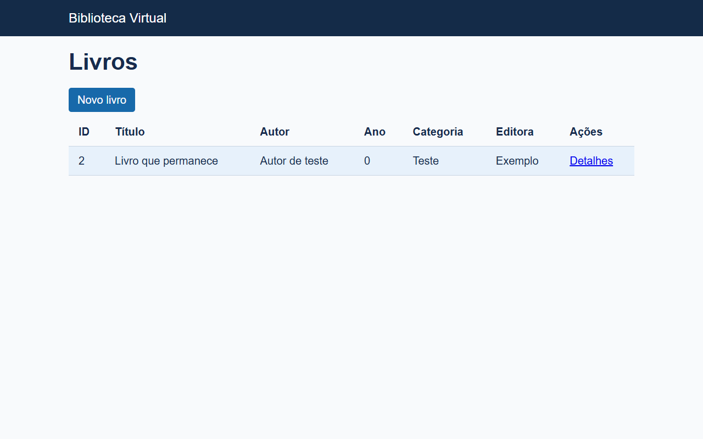

# Aula 5: exercícios guiados de CRUD

**Data:** 17/11/2026  
**Tema:** CRUD

**Ponto de partida:** projeto Flask e SQLite da Aula 4. Usem a mesma pasta do projeto e o mesmo `database/biblioteca.db`. Se começarem numa cópia nova, cadastrem dois livros pelo formulário. Usem livros de teste para praticar a exclusão.

Com o ambiente virtual ativo, iniciem o projeto com `python app.py` e abram http://127.0.0.1:5000/livros. Quando alterarem o código Python, reiniciamos o servidor.

---

## 1. Consultar um livro pelo ID

Na listagem da Aula 4, já temos o ID de cada livro. Vamos anotar dois IDs. Mesmo que os títulos sejam iguais, os IDs são diferentes.

Em `app.py`, antes da chamada a `criar_tabela()`, acrescentamos a busca abaixo. Ela usa `WHERE id = ?` para restringir o resultado e `fetchone()` para obter uma linha. A vírgula em `(id,)` forma uma tupla de um elemento. O teste de tamanho evita enviar ao SQLite um ID maior que o banco pode armazenar.

~~~python
def buscar_livro(id):
    if id >= 2**63:
        return None

    conexao = conectar()
    try:
        return conexao.execute(
            "SELECT * FROM livros WHERE id = ?", (id,)
        ).fetchone()
    finally:
        conexao.close()
~~~

Logo abaixo, acrescentamos uma rota provisória para testar a consulta. O trecho `<int:id>` recebe o número da URL e o passa para a função.

~~~python
@app.route("/livros/<int:id>")
def detalhar_livro(id):
    livro = buscar_livro(id)
    if livro is None:
        return "Livro não encontrado", 404
    return livro["titulo"]
~~~

**Conferimos:** em `/livros/1`, substituímos `1` pelo ID anotado e vemos o título. Com um ID inexistente, recebemos a mensagem de livro não encontrado e o código 404.

---

## 2. Abrir os detalhes a partir da lista

Criamos `templates/detalhes.html` com o conteúdo abaixo. Reusamos o layout e mostramos a descrição, que já era guardada no banco.

~~~html



<h1>{{ livro.titulo }}</h1>

Livro #{{ livro.id }}

<dl>
    <dt>Autor</dt>
    <dd>{{ livro.autor }}</dd>
    <dt>Ano</dt>
    <dd>{{ livro.ano if livro.ano is not none else "Não informado" }}</dd>
    <dt>Categoria</dt>
    <dd>{{ livro.categoria or "Não informada" }}</dd>
    <dt>Editora</dt>
    <dd>{{ livro.editora or "Não informada" }}</dd>
    <dt>Descrição</dt>
    <dd>{{ livro.descricao or "Sem descrição" }}</dd>
</dl>

<a class="btn btn-primary" href="{{ url_for('listar_livros') }}">Voltar à lista</a>

~~~

Na rota do exercício anterior, trocamos `return livro["titulo"]` por:

~~~python
return render_template("detalhes.html", livro=livro)
~~~

Em `templates/livros.html`, acrescentamos `<th>Ações</th>` após o cabeçalho de editora. Dentro do `for`, acrescentamos uma célula após a editora. Na linha vazia, mudamos o `colspan` de `6` para `7`.

~~~html
<td><a href="{{ url_for('detalhar_livro', id=livro.id) }}">Detalhes</a></td>
~~~

**Conferimos:** clicamos em **Detalhes** nos dois livros e observamos que cada link usa o ID da linha correspondente.

---

## 3. Abrir a edição com os valores atuais

Primeiro implementamos o GET da edição. Acrescentamos a rota abaixo antes de `criar_tabela()`.

~~~python
@app.route("/livros/<int:id>/editar")
def editar_livro(id):
    livro = buscar_livro(id)
    if livro is None:
        return "Livro não encontrado", 404
    return render_template("cadastrar.html", livro=livro)
~~~

Em `templates/cadastrar.html`, passamos a usar os mesmos campos para cadastrar e editar. Quando recebemos `livro`, preenchemos os campos. No cadastro, mantemos os campos vazios. Usamos `value` nos campos `input` e colocamos a descrição entre as tags de `textarea`.

Trocamos o cabeçalho do formulário por:

~~~html

<h1>{{ "Editar livro" if editando else "Novo livro" }}</h1>
~~~

Nos campos existentes, acrescentamos os atributos `value` abaixo. Mantemos os demais atributos, como `name` e `required`.

| Campo | Atributo a acrescentar |
|---|---|
| Título | `value="{{ livro.titulo if editando else '' }}"` |
| Autor | `value="{{ livro.autor if editando else '' }}"` |
| Ano | `value="{{ livro.ano if editando and livro.ano is not none else '' }}"` |
| Categoria | `value="{{ (livro.categoria or '') if editando else '' }}"` |
| Editora | `value="{{ (livro.editora or '') if editando else '' }}"` |

No campo descrição, preenchimos o conteúdo desta forma:

~~~html
<textarea class="form-control" id="descricao" name="descricao">{{ (livro.descricao or '') if editando else '' }}</textarea>
~~~

Acrescentamos este link em `detalhes.html`, antes de ``:

~~~html
<a class="btn btn-warning" href="{{ url_for('editar_livro', id=livro.id) }}">Editar</a>
~~~

**Conferimos:** abrimos **Editar** e comparamos os valores com os detalhes. Depois, abrimos **Novo livro** e conferimos os campos vazios. Vamos testar **Salvar** na edição depois de implementar o POST.

---

## 4. Reaproveitar a validação do cadastro

No início de `cadastrar_livro()`, na Aula 4, já lemos e validamos os campos. Colocamos essa parte em `ler_campos_livro()`, acima da rota de cadastro, para usá-la nas duas operações.

~~~python
def ler_campos_livro(form):
    titulo = form.get("titulo", "").strip()
    autor = form.get("autor", "").strip()
    ano_texto = form.get("ano", "").strip()
    categoria = form.get("categoria", "").strip()
    editora = form.get("editora", "").strip()
    descricao = form.get("descricao", "").strip()

    if not titulo or not autor:
        raise ValueError("Título e autor são obrigatórios")

    try:
        ano = int(ano_texto) if ano_texto else None
    except ValueError:
        raise ValueError("O ano deve ser um número inteiro") from None
    if ano is not None and not -(2**63) <= ano < 2**63:
        raise ValueError("Ano fora do intervalo de inteiros do SQLite")

    return titulo, autor, ano, categoria, editora, descricao
~~~

No ramo POST de `cadastrar_livro()`, substituímos a leitura e validação pela chamada abaixo. Mantemos o mesmo `INSERT` e passamos `campos` como segundo argumento de `conexao.execute()), no lugar da antiga tupla de valores.

~~~python
try:
    campos = ler_campos_livro(request.form)
except ValueError as erro:
    return str(erro), 400
~~~

**Conferimos:** ainda conseguimos cadastrar um livro. Se enviarmos um título só com espaços, recebemos 400. O ano pode ficar vazio e, quando preenchido, precisa ser um inteiro aceito pelo SQLite.

---

## 5. Salvar a edição com UPDATE

Substituímos a rota de edição pela versão abaixo. O GET abre o formulário. No POST, lemos os campos e usamos `UPDATE` para alterar a linha existente. No final da tupla, acrescentamos o ID usado pelo último `?` do comando.

~~~python
@app.route("/livros/<int:id>/editar", methods=["GET", "POST"])
def editar_livro(id):
    livro = buscar_livro(id)
    if livro is None:
        return "Livro não encontrado", 404

    if request.method == "GET":
        return render_template("cadastrar.html", livro=livro)

    try:
        campos = ler_campos_livro(request.form)
    except ValueError as erro:
        return str(erro), 400

    conexao = conectar()
    try:
        resultado = conexao.execute(
            """
            UPDATE livros
            SET titulo = ?, autor = ?, ano = ?, categoria = ?,
                editora = ?, descricao = ?
            WHERE id = ?
            """,
            (*campos, id),
        )
        conexao.commit()
    finally:
        conexao.close()

    if resultado.rowcount == 0:
        return "Livro não encontrado", 404
    return redirect(url_for("detalhar_livro", id=id))
~~~

`WHERE id = ?` limita a alteração a um livro. Depois de `commit()`, voltamos aos detalhes do mesmo ID. Se o registro já tiver sido removido, `rowcount` permite detectar que nenhuma linha foi atualizada e devolver 404.

**Conferimos:** alteramos o título de um livro e salvamos. Voltamos à listagem e verificamos o novo título, o mesmo ID e o outro livro intacto.

---

## 6. Excluir um livro com DELETE

Acrescentamos a rota antes de `criar_tabela()`. Usamos POST porque a exclusão altera o banco. Assim como na edição, usamos o ID no `WHERE` e confirmamos a operação com `commit()`.

~~~python
@app.route("/livros/<int:id>/excluir", methods=["POST"])
def excluir_livro(id):
    if id >= 2**63:
        return "Livro não encontrado", 404

    conexao = conectar()
    try:
        resultado = conexao.execute(
            "DELETE FROM livros WHERE id = ?", (id,)
        )
        conexao.commit()
    finally:
        conexao.close()

    if resultado.rowcount == 0:
        return "Livro não encontrado", 404
    return redirect(url_for("listar_livros"))
~~~

Em `detalhes.html`, antes de ``, acrescentamos o formulário:

~~~html
<form method="post" action="{{ url_for('excluir_livro', id=livro.id) }}"
      onsubmit="return confirm('Deseja realmente excluir este livro?')"
      style="display: inline-block">
    <button class="btn btn-danger" type="submit">Excluir</button>
</form>
~~~

Podemos acrescentar duas cores ao CSS local, usadas quando o Bootstrap estiver indisponível:

~~~css
.btn-warning { background: #785600; }
.btn-danger { background: #a52b32; }
~~~

**Conferimos:** clicamos em **Excluir** e cancelamos a confirmação. O livro continua na página. Repetimos e confirmamos. Voltamos à listagem, reabrimos a URL antiga dos detalhes e recebemos 404. O outro livro continua na tabela. A confirmação ocorre no navegador e a exclusão é executada pelo servidor.

---

## 7. Repetir o ciclo completo

1. Cadastrem um livro de teste e anotem o ID.
2. Abram os detalhes, editem o título e confiram a mudança na listagem.
3. Excluam o livro e verifiquem que o endereço antigo retorna 404.
4. Reiniciem o servidor e confiram que o livro continua ausente e que os outros cadastros permanecem.

Ao terminar, relacionem cada etapa ao comando SQL: `INSERT` cria, `SELECT` consulta, `UPDATE` altera e `DELETE` exclui.

No repositório do projeto, registrem o avanço:

~~~bat
git add .
git commit -m "Aula 5 - CRUD completo"
~~~
