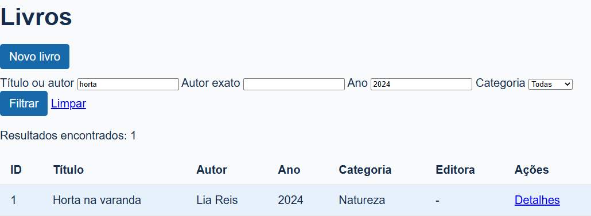
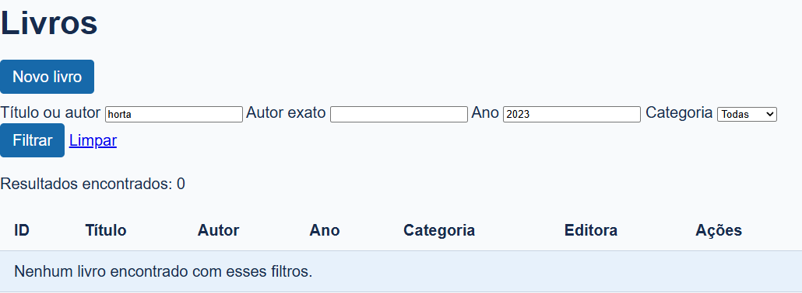

# Aula 6: exercícios guiados de busca e filtros

**Data:** 24/11/2026

Continuaremos após o que concluímos na Aula 5, ao lado de `app.py`, com o mesmo `database/biblioteca.db`. Com o ambiente virtual ativo, executamos `python app.py` e abrimos `http://127.0.0.1:5000/livros`. Lembrem que depois de editar o código ou os templates de cada exercício, tem que encerrar o servidor com `Ctrl+C`, executar de novo `python app.py` e atualizar a página.

---

## 1. Preparar livros para comparar

Antes de alterar o código, abrimos os **Detalhes** de um livro da Aula 5 e anotamos seu ID. Se começamos com o banco vazio, fazemos essa conferência após o primeiro cadastro. Em **Novo livro**, cadastramos os títulos da tabela que ainda faltam. Conservamos os livros anteriores. As contagens das imagens consideram apenas os dez exemplos. Se outros livros também atenderem ao filtro, somamos essas linhas ao resultado esperado.

| Título | Autor | Ano | Categoria |
|---|---|---:|---|
| Horta na varanda | Lia Reis | 2024 | Natureza |
| Guia da horta | Rui Luz | 2022 | Natureza |
| Aves do bairro | Lia Reis | 2024 | Natureza |
| Mapa das trilhas | Bia Melo | 2020 | Viagem |
| Diário de bordo | Rui Luz | 2021 | Viagem |
| Rotas de trem | Bia Melo | 2023 | Viagem |
| Sabores da feira | Lia Reis | 2022 | Cozinha |
| Pães de domingo | Rui Luz | 2024 | Cozinha |
| Receitas de verão | Bia Melo | 2023 | Cozinha |
| Trilhas da serra | Bia Melo | 2020 | Viagem |

**Conferimos:** localizamos os dois títulos com a palavra “horta”. Anotamos o autor e o ano de cada um.

---

## 2. Buscar uma palavra na URL

Em `app.py`, dentro de `listar_livros()`, antes de abrir a conexão, acrescentamos o trecho abaixo. Alinhamos a primeira linha com `conexao = conectar()`. No bloco seguinte, alinhamos a consulta com a linha que substituímos dentro do `try`. Em `/livros?busca=horta`, o trecho após `?` é a *query string*. Com `request.args`, lemos o valor associado a `busca`.

~~~python
busca = request.args.get("busca", "").strip()
sql = "SELECT * FROM livros WHERE 1=1"
parametros = []
if busca:
    sql += " AND (titulo LIKE ? OR autor LIKE ?)"
    termo = f"%{busca}%"
    parametros.extend([termo, termo])
sql += " ORDER BY titulo"
~~~

Dentro do `try`, substituímos a consulta que preenchia `livros` por esta linha. Mantemos o fechamento da conexão e o retorno do template.

~~~python
livros = conexao.execute(sql, parametros).fetchall()
~~~

O sinal `%` aceita qualquer sequência antes ou depois da palavra. Os dois `?` recebem o mesmo termo, um para o título e outro para o autor. Ao passar os valores em separado, podemos pesquisar inclusive palavras com apóstrofo.

**Conferimos:** abrimos `/livros?busca=horta` e encontramos os dois títulos anotados. Trocamos `horta` por `Lia` e encontramos os livros da autora.

---

## 3. Combinar dois critérios

Antes de `sql += " ORDER BY titulo"`, acrescentamos os filtros abaixo. Partimos de `WHERE 1=1`, uma condição sempre verdadeira. Cada `AND` acrescenta uma exigência. Os parênteses na busca anterior fazem o filtro de ano valer tanto para título quanto para autor.

~~~python
autor = request.args.get("autor", "").strip()
ano = request.args.get("ano", "").strip()
categoria = request.args.get("categoria", "").strip()
if autor:
    sql += " AND autor = ?"
    parametros.append(autor)
if ano:
    sql += " AND ano = ?"
    parametros.append(ano)
if categoria:
    sql += " AND categoria = ?"
    parametros.append(categoria)
~~~

**Conferimos:** abrimos `/livros?busca=horta&ano=2024`. O sinal `&` separa os parâmetros. Dos dois títulos, fica apenas *Horta na varanda*. Em `/livros?autor=Lia%20Reis`, encontramos os três livros de Lia.

---

## 4. Escolher os filtros na tela

Na mesma rota, dentro do `try`, logo depois de buscar os livros, consultamos as categorias do acervo. Com `DISTINCT`, cada categoria aparece uma vez, mesmo que vários livros a utilizem.

~~~python
categorias = conexao.execute("""
    SELECT DISTINCT categoria FROM livros
    WHERE categoria IS NOT NULL AND categoria <> ''
    ORDER BY categoria
""").fetchall()
~~~

Na chamada a `render_template`, acrescentamos `categorias=categorias` depois de `livros=livros`. Em `templates/livros.html`, antes da tabela, incluímos o formulário. O método GET coloca os campos na URL. Com `value` e `selected`, conservamos as escolhas ao mostrar o resultado.

~~~html
<form method="get" class="mb-3">
    <label>Título ou autor <input name="busca" value="{{ request.args.get('busca', '') }}"></label>
    <label>Autor exato <input name="autor" value="{{ request.args.get('autor', '') }}"></label>
    <label>Ano <input type="number" name="ano" value="{{ request.args.get('ano', '') }}"></label>
    <label>Categoria
        <select name="categoria">
            <option value="">Todas</option>
            
            <option selected>{{ item.categoria }}</option>
            
        </select>
    </label>
    <button class="btn" type="submit">Filtrar</button>
    <a href="{{ url_for('listar_livros') }}">Limpar</a>
</form>
~~~

**Conferimos:** selecionamos **Natureza**, pesquisamos *horta* e clicamos em **Filtrar**. Vemos dois livros. Ao clicar em **Limpar**, recuperamos a lista completa.

---

## 5. Contar os resultados e testar a lista vazia

Logo depois do formulário, acrescentamos a contagem das linhas retornadas.

~~~html

Resultados encontrados: {{ livros|length }}

~~~

Dentro da célula com `colspan="7"`, substituímos a mensagem antiga pela expressão abaixo. Quando a tabela fica vazia, identificamos se chegamos ali após enviar o formulário.

~~~html
{{ "Nenhum livro encontrado com esses filtros." if request.args else "Nenhum livro cadastrado." }}
~~~

**Conferimos:** buscamos *horta* e escolhemos o ano 2024. Lemos a contagem e conferimos o título. Depois trocamos o ano para 2023. Entre os exemplos, a contagem passa a zero. Se houver outro livro que atenda aos filtros, pesquisamos um título ausente do nosso acervo para ver a mensagem. Ao limpar os filtros, os cadastros continuam lá.

